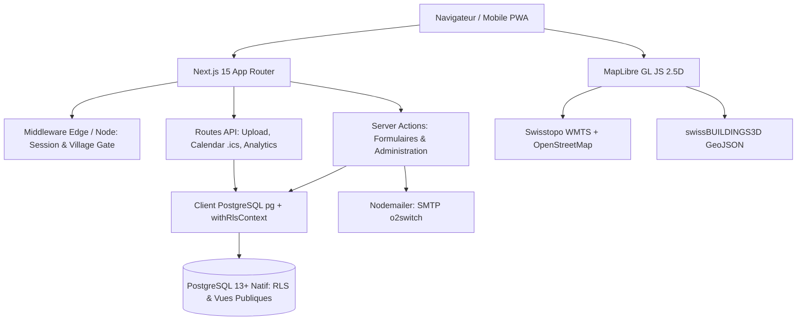
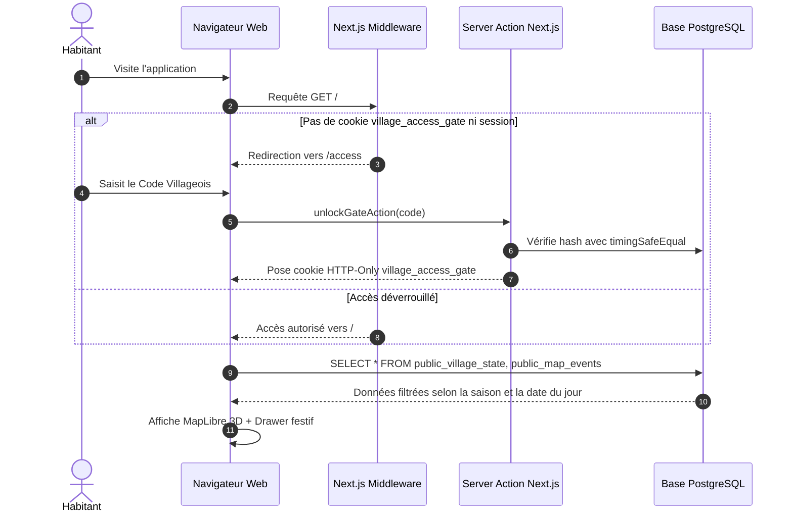

# 1. Architecture Globale

Ce document détaille l'architecture logicielle, les choix techniques, les flux de données et l'organisation du projet **Village en Fête**.

---

## 🎯 Objectif et Philosophie

Village en Fête est conçu pour offrir une expérience interactive, festive et sécurisée aux habitants d'une commune :
1. **Zéro dépendance propriétaire externe (Vendor Lock-in)** : Ni Supabase, ni Firebase, ni service BaaS payant. L'ensemble de la logique métier, de l'authentification et de la sécurité réside dans le code Next.js et PostgreSQL standard.
2. **Adapté aux hébergements mutualisés & VPS** : Optimisé pour tourner sur une formule mutualisée cPanel (type o2switch) ou un petit serveur VPS avec un faible encombrement mémoire.
3. **Approche hyper-locale et vie privée** : Les informations précises sur les résidents sont masquées au grand public et réservées aux villageois disposant du sésame d'accès (Code Villageois).
4. **Performance & PWA** : Rendu serveur pour les pages administratives et le chargement initial, client riche (MapLibre GL, Framer Motion) pour la carte 2.5D, avec support hors-ligne de base.

---

## 🧱 Stack Technologique



### Front-End & Rendu
- **Next.js 15.0+ (App Router)** : Gestion des routes, Server Components pour le pré-rendu sécurisé et Server Actions pour les mutations.
- **React 19** : Utilisation des hooks modernes et des transitions serveur.
- **Tailwind CSS 3.4** : Stylisation réactive avec thèmes dynamiques (Halloween / Avent).
- **Framer Motion** : Animations fluides pour les fenêtres tiroirs (*MobileDrawer*), marqueurs flottants (*FloatingMarker*) et transitions d'état.
- **MapLibre GL JS 4.7** : Rendu cartographique WebGL haute performance, affichage de polygones extrudés 3D sans dépendance à des clés tierces payantes.
- **Lucide React** : Icônes vectorielles cohérentes et légères.

### Back-End & Sécurité
- **pg (node-postgres)** : Pool de connexions direct à PostgreSQL (`max: 10`), compatible avec les limites des hébergements mutualisés.
- **jose** : Création et vérification de JWT chiffrés et signés (HS256) pour les sessions HTTP-Only et la clé de passage (*Gate Cookie*).
- **Zod 3.23** : Validation stricte des schémas d'entrée sur chaque Server Action et API Route.
- **Nodemailer** : Transport SMTP standard pour l'envoi des Magic Links et rappels de festivité.
- **Node.js Crypto natif** : Hachage SHA-256 et comparaison temporelle constante (`timingSafeEqual`).

---

## 📂 Arborescence Détaillée du Projet

```text
village-map/
├── .env.example                     # Modèle de variables d'environnement
├── docker-compose.yml               # Déploiement local ou serveur PostgreSQL
├── package.json                     # Dépendances et scripts npm
├── tsconfig.json                    # Configuration TypeScript stricte
├── tailwind.config.ts               # Configuration Tailwind avec palette thématique
│
├── db/                              # Gestion de la base de données
│   ├── migrations/                  # 7 migrations SQL versionnées
│   │   ├── 0001_schema.sql          # Schéma de base autonome (tables, enums, triggers)
│   │   ├── 0002_rls.sql             # Politiques de sécurité RLS PostgreSQL
│   │   ├── 0003_views.sql           # Vues filtrées pour l'accès public
│   │   ├── 0004_advent_workflow.sql # Workflow d'attribution et verrouillage Avent
│   │   ├── 0005_enhancements.sql    # Signalement out_of_candy & rate limiting
│   │   ├── 0006_advent_custom_formula.sql # Libellé d'activité personnalisée
│   │   └── 0007_features.sql        # PMR, photos et analytics discrets
│   └── seed.sql                     # Adresses de test initiales
│
├── data/                            # Référentiel cadastral brut
│   └── README.md                    # Format attendu pour les adresses communales
│
├── public/                          # Fichiers statiques servis directement
│   ├── data/
│   │   └── vufflens-buildings-3d.geojson # Empreintes 3D des bâtiments communaux
│   ├── icon.svg                     # Icône vectorielle PWA
│   ├── manifest.json                # Configuration Web App Manifest
│   └── sw.js                        # Service Worker pour le cache réseau
│
├── scripts/                         # Outils CLI d'exploitation
│   ├── migrate.ts                   # Exécution des migrations SQL
│   ├── import-addresses.ts          # Import GeoJSON vers la table `addresses`
│   ├── fetch-vufflens-3d.ts         # Récupération Swisstopo & OpenStreetMap
│   └── enrich-vufflens-3d.ts        # Calculs géodésiques et hauteurs de toits
│
├── src/                             # Code applicatif Next.js
│   ├── middleware.ts                # Protection des routes (JWT session + gate)
│   ├── types/
│   │   └── index.ts                 # Interfaces TypeScript globales
│   │
│   ├── lib/                         # Bibliothèque d'utilitaires transverses
│   │   ├── db.ts                    # Connexion Pool pg + helper withRlsContext
│   │   ├── auth.ts                  # Logique JWT, SHA-256, cookies de session
│   │   ├── mail.ts                  # Modèles de mails et client SMTP Nodemailer
│   │   ├── rateLimit.ts             # Protection anti-abus par IP en base de données
│   │   ├── schemas.ts               # Schémas de validation Zod
│   │   ├── themeTokens.ts           # Palettes et styles dynamiques par saison
│   │   └── utils.ts                 # Calculs géographiques et helpers CSS
│   │
│   ├── components/                  # Composants React
│   │   ├── ui/                      # Composants génériques (boutons, inputs)
│   │   ├── map/                     # Composants cartographiques
│   │   │   ├── Map3DContainer.tsx   # Conteneur principal MapLibre GL
│   │   │   ├── FloatingMarker.tsx   # Marqueurs festifs 3D sur la carte
│   │   │   ├── MobileDrawer.tsx     # Tiroir rétractable d'exploration & itinéraire
│   │   │   ├── AtmosphericParticles.tsx # Particules interactives (neige / braises)
│   │   │   └── VillageInteractiveMap.tsx # Alias d'export
│   │   ├── AddressAutocompleteAndMap.tsx # Sélection d'adresse avec autocomplétion
│   │   ├── AdventDayPickerForm.tsx  # Formulaire de sélection de date (1-24)
│   │   ├── PhotoUploadField.tsx     # Upload d'image avec aperçu
│   │   └── PrintPosterButton.tsx    # Déclencheur d'impression de l'affiche communale
│   │
│   └── app/                         # Arborescence des pages (App Router)
│       ├── page.tsx                 # Carte interactive principale (accueil)
│       ├── access/page.tsx          # Formulaire du Code Villageois (Gate)
│       ├── login/page.tsx           # Connexion habitant par Magic Link
│       ├── verify/page.tsx          # Validation d'adresse de domicile
│       ├── dashboard/page.tsx       # Espace citoyen (gestion des inscriptions)
│       ├── halloween/page.tsx       # Inscription à la tournée d'Halloween
│       ├── advent/page.tsx          # Inscription aux Fenêtres de l'Avent
│       ├── admin/
│       │   ├── page.tsx             # Tableau de bord municipal (gestion globale)
│       │   ├── login/page.tsx       # Accès direct administrateur
│       │   └── print-advent/page.tsx# Page d'impression de l'affiche de l'Avent
│       ├── actions/                 # Server Actions Next.js (mutations sécurisées)
│       │   ├── admin.ts
│       │   ├── advent.ts
│       │   ├── auth.ts
│       │   ├── halloween.ts
│       │   └── verify-residence.ts
│       └── api/                     # Endpoints HTTP
│           ├── calendar/export/route.ts # Export iCalendar RFC 5545 (.ics)
│           ├── upload/route.ts          # Upload sécurisé de photos
│           └── analytics/ping/route.ts  # Télémétrie anonyme de fréquentation
│
└── tests/                           # Suite de tests unitaires et d'isolation
    ├── auth.test.ts                 # Tests cryptographiques et sessions
    ├── dev-isolation.test.ts        # Tests de non-régression dev vs production
    ├── geo.test.ts                  # Calculs Haversine et estimation piétonne
    ├── calendar-export.test.ts      # Conformité du format RFC 5545 .ics
    └── validation.test.ts           # Validation stricte des schémas Zod
```

---

## 🔄 Flux de Données et Cycle de Requête


