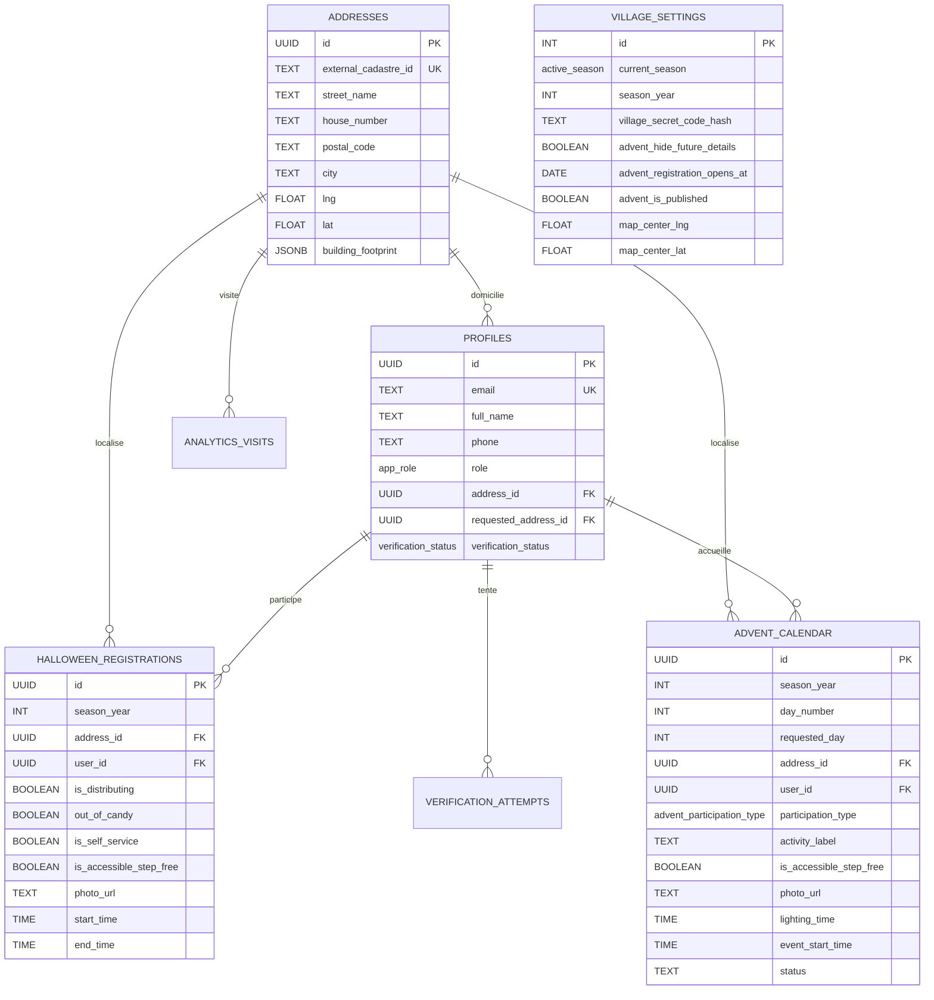

# 3. Base de Données & Migrations

Ce document détaille le modèle relationnel PostgreSQL, les 7 migrations successives, les politiques de Row-Level Security (RLS) et les scripts d'exploitation de données de **Village en Fête**.

---

## 🏛️ Vue d'Ensemble du Schéma

La base de données repose sur PostgreSQL 13+ standard, sans nécessiter d'extensions restreintes (ni `postgis` obligatoire, ni superutilisateur).



---

## 📜 Historique Détaillé des Migrations

Les fichiers de migration sont situés dans `db/migrations/` et sont appliqués par ordre numérique par le script `scripts/migrate.ts`.

### `0001_schema.sql` — Structure Fondamentale
- Définit les énumérations : `app_role` (`resident`, `moderator`, `admin`), `verification_status`, `active_season`, `advent_participation_type`.
- Crée la table **`addresses`** : Référentiel officiel communal (adresse postale, coordonnées WGS84 `lng`/`lat`, polygone GeoJSON optionnel).
- Crée la table **`profiles`** : Utilisateurs fusionnés avec leur profil, statut de vérification et adresse rattachée. Un index unique partiel garantit **un seul foyer vérifié par adresse physique**.
- Crée la table **`magic_links`** : Stockage haché SHA-256 des tokens à durée limitée.
- Crée le singleton **`village_settings`** (`id = 1`) : Paramètres globaux (saison active, année, hash du code villageois, coordonnées cartographiques par défaut).
- Crée les tables d'inscription **`halloween_registrations`** et **`advent_calendar`**.
- Crée la table **`verification_attempts`** et le trigger automatique `set_updated_at()`.

### `0002_rls.sql` — Politiques de Sécurité RLS
Active `ROW LEVEL SECURITY` sur chaque table sensible :
- Utilise la variable locale de transaction `current_setting('app.current_user_id', true)`.
- **`profiles`** : Chaque résident ne peut lire et modifier que son propre profil ; les administrateurs ont une visibilité complète.
- **`halloween_registrations`** & **`advent_calendar`** : Lecture autorisée pour les inscriptions approuvées ; écriture restreinte au propriétaire du foyer ou aux administrateurs.

### `0003_views.sql` — Vues Publiques Sécurisées
- **`public_village_state`** : Expose les paramètres de la carte et la saison active sans divulguer le hash du code villageois ni les métadonnées internes.
- **`public_map_events`** : Jointure sécurisée fournissant les points d'animation sur la carte.
  - Masque automatiquement les détails d'accueil et horaires des fenêtres de l'Avent futures si `advent_hide_future_details = true` et que le jour J n'est pas encore atteint (remplacé côté serveur par *"Détails dévoilés le jour J"*).

### `0004_advent_workflow.sql` — Workflow de l'Avent
- Ajout de `advent_registration_opens_at` et `advent_is_published` dans `village_settings`.
- Ajout de `requested_day`, `admin_notes` et du statut (`submitted`, `assigned`, `rejected`) dans `advent_calendar`.
- **Verrouillage temps réel** : Dès qu'une candidature est soumise pour un jour (1 à 24), l'index unique `idx_advent_unique_active_day` empêche toute double réservation d'un même jour.
- Création de la vue **`advent_taken_days`** pour afficher les dates déjà occupées.

### `0005_enhancements.sql` — "Plus de Bonbons" & Rate Limiting
- Ajout du drapeau temps réel `out_of_candy` sur `halloween_registrations`. Permet à un habitant dévalisé de signaler instantanément l'épuisement de ses friandises, grisant son marqueur sur la carte.
- Création de la table **`rate_limits`** (`ip_key`, `action`, `attempted_at`) pour limiter les attaques par force brute.
- Mise à jour de la vue `public_map_events` avec le champ `out_of_candy`.

### `0006_advent_custom_formula.sql` — Formule d'Animation Personnalisée
- Ajout du champ texte libre `activity_label` dans `advent_calendar` (ex: *"Lecture de contes"*, *"Partage d'une soupe à la courge"*, *"Vin chaud & guirlandes"*, *"Fenêtre lumineuse"*).
- Exposition directe dans `public_map_events`.

### `0007_features.sql` — Accessibilité, Photos & Analytics
- Ajout de `is_accessible_step_free` (filtre PMR / poussettes sans marches) sur Halloween et l'Avent.
- Ajout de `photo_url` (galerie photo des fenêtres décorées ou façades hantées).
- Création de la table **`analytics_visits`** : Journalisation discrète et respectueuse de la vie privée (`event_type`: `page_view`, `address_view`, `route_view`) pour mesurer la fréquentation communale.
- Mise à jour finale de la vue `public_map_events`.

### `0008_communal_alerts.sql` — Alertes & Flash Communal en Direct
- Création de la table **`village_alerts`** (`id`, `level`, `title`, `message`, `is_active`, `created_at`, `created_by`).
- Permet à la commune d'envoyer instantanément une notification visuelle et sonore par Server-Sent Events (SSE) sur tous les téléphones et ordinateurs connectés en même temps (météo, repli sous préau, fin de tournée).

### `0009_advent_communal_slots.sql` — Créneaux Communaux & Blocages de Dates
- Modification de **`advent_calendar`** :
  - `ALTER COLUMN address_id DROP NOT NULL` (permet de bloquer un jour sans adresse associée).
  - `ALTER COLUMN user_id DROP NOT NULL` (permet des événements communaux sans profil habitant individuel).
  - `ADD COLUMN is_communal_event BOOLEAN NOT NULL DEFAULT false`.
  - `ADD COLUMN block_reason TEXT` (motif explicite du blocage : fête de l'école, paroisse, jour férié).
  - Élargissement de la contrainte `CHECK (status IN ('submitted', 'assigned', 'rejected', 'reserved_commune', 'blocked'))`.
- Mise à jour de la vue **`advent_taken_days`** avec `is_communal_event` et `block_reason`.
- Mise à jour de la vue cartographique **`public_map_events`** pour intégrer automatiquement les événements communaux (`status IN ('assigned', 'reserved_commune')`).

### `0010_advent_proposals_and_deadline.sql` — Propositions d'Avent & Date Limite de Désinscription
- Ajout de `advent_cancellation_deadline DATE` dans `village_settings`.
- Mise à jour de la vue **`public_village_state`** avec `advent_cancellation_deadline` et le booléen calculé `advent_cancellation_closed`.
- Les habitants émettent un souhait de date (`requested_day`) en statut `submitted` sans préempter le jour ; l'attribution officielle (`day_number`) est réservée à la commune.
- Désinscription citoyenne autorisée en 1 clic jusqu'à la date limite fixée par la commune.

---

## 🛠️ Scripts de Données et CLI

Le projet inclut des scripts TypeScript exécutables en ligne de commande :

```bash
# 1. Appliquer les migrations SQL et le seed initial
npm run db:migrate

# 2. Importer le cadastre officiel Swisstopo & OpenStreetMap (pour Vufflens-la-Ville ou autre)
npm run fetch:vufflens

# 3. Importer un fichier GeoJSON d'adresses personnalisé
npm run import:addresses
```

### Détail des scripts :
- **`scripts/migrate.ts`** : Parcourt chronologiquement `db/migrations/`, applique les scripts non exécutés dans une transaction, puis injecte `db/seed.sql` si la table `addresses` est vide.
- **`scripts/fetch-vufflens-3d.ts`** : Interroge les API officielles Swisstopo (RegBL) et l'Overpass API OpenStreetMap pour récupérer les polygones de bâtiments, génère `public/data/vufflens-buildings-3d.geojson` et peuple la table `addresses`.
- **`scripts/enrich-vufflens-3d.ts`** : Calcule les hauteurs, centroïdes et niveaux pour l'extrusion 3D sur la carte MapLibre.
