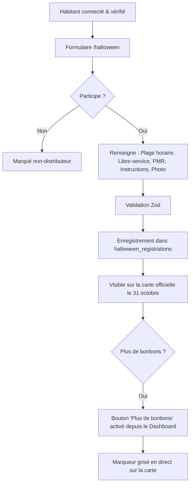
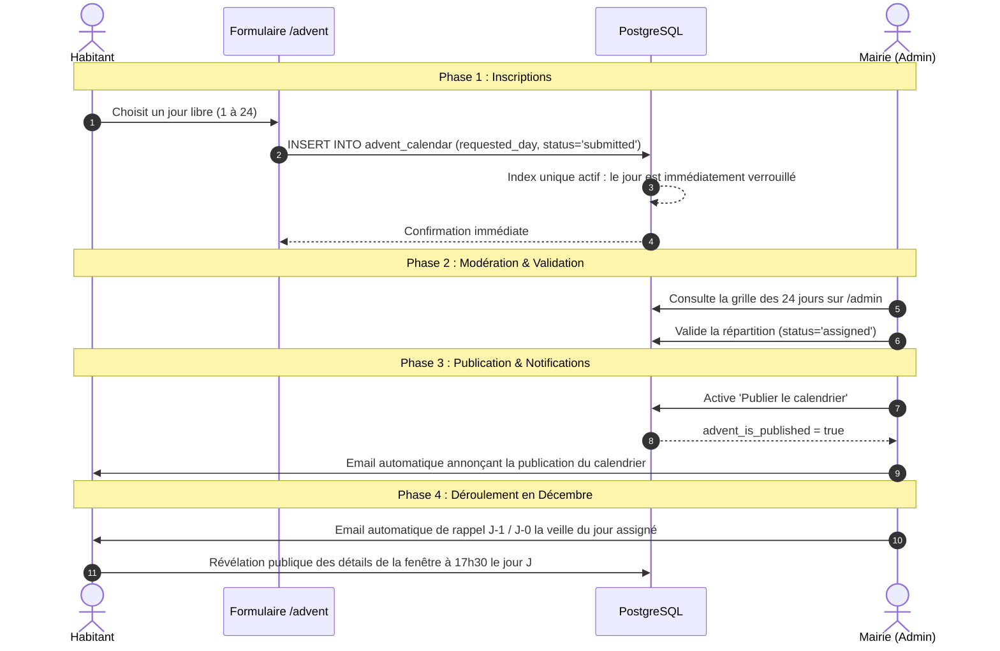

# 5. Saisons & Workflows Métier

Ce document décrit le cycle de vie annuel, la gestion des deux fêtes phares (**Halloween** et **Fenêtres de l'Avent**) et les processus administratifs communaux de **Village en Fête**.

---

## 📅 Cycle de Vie Annuel des Saisons

L'application gère 3 états saisonniers configurables depuis `/admin` :

```
             ┌──────────────────────────────────────────────┐
             │                                              ▼
    [ Hors-Saison ] ──────► [ Halloween 🎃 ] ──────► [ Fenêtres de l'Avent 🎄 ]
   (Printemps / Été)            (Octobre)                    (Novembre / Décembre)
```

1. **`off_season` (Hors-Saison)** :
   - La carte affiche le village au repos.
   - Les habitants peuvent valider leur adresse de domicile en vue des prochaines fêtes.
   - Les formulaires d'inscription affichent les dates d'ouverture prévues.
2. **`halloween` (Halloween)** :
   - Thème visuel citrouille, sombre et orange.
   - Inscription des maisons distributrices de bonbons.
   - Signalement *"En libre-service"* ou *"Sonnez à la porte"*.
   - Statut direct *"Plus de bonbons"* activable par l'habitant pendant la soirée.
3. **`advent` (Fenêtres de l'Avent)** :
   - Thème féerique or et bleu nuit, neige en arrière-plan.
   - Réservation d'un jour précis du calendrier (du 1er au 24 décembre).
   - Formule : Fenêtre décorée seule ou Accueil convivial (vin chaud, soupe, contes).
   - Masquage serveur des surprises jusqu'au jour J.

---

## 🎃 Workflow Halloween



---

## 🎄 Workflow Fenêtres de l'Avent

Le workflow de l'Avent concilie équité citoyenne, verrouillage anti-doublon et modération communale :



### Règles clés de l'Avent :
- **Un seul foyer par jour** : Dès qu'une candidature est déposée pour le 12 décembre, aucune autre famille ne peut sélectionner le 12.
- **Règles de visibilité jusqu'au jour J** : La vue SQL `public_map_events` filtre les détails :
  - *Avant le jour J* : La fenêtre affiche uniquement son numéro et son adresse. Les détails de la verrée et l'heure précise restent secrets.
  - *Le jour J* : Les détails complets sont automatiquement révélés pour inciter les villageois à se rassembler.
- **Pré-réservation & Blocage de dates par la Commune** :
  - **Pré-réservation communale** : La commune peut pré-réserver des dates officielles (ex: 1er décembre pour l'inauguration à la Maison de Commune, 6 décembre pour la Saint-Nicolas, 24 décembre pour le réveillon). Ces dates apparaissent avec un badge violet distinct sur l'administration et sur la carte interactive avec leur adresse et leur formule.
  - **Blocage de dates sans animation** : La commune peut bloquer certains jours (soirée de spectacle de l'école, cultes de la paroisse, jours fériés). Ces dates sont grisées/hachurées pour les habitants avec le motif explicite, et ne figurent pas sur la carte publique.
  - **Libération en 1 clic** : L'administrateur peut à tout moment débloquer ou libérer une date communale pour la remettre immédiatement à disposition des habitants.

- **Affiche Communale Prête pour Impression** :
  - La route `/admin/print-advent` génère une page stylisée A4/A3 au format grille 1 à 24 prête à être imprimée pour affichage au tableau communal de la mairie, à l'école ou à l'épicerie du village.

---

## 📬 Système de Rappels par Email

Le module `src/lib/mail.ts` gère l'envoi de courriels personnalisés :
1. **Magic Link de connexion** : Lien sécurisé à usage unique.
2. **Confirmation d'adresse validée** : Prévenant l'habitant que son foyer est reconnu.
3. **Publication officielle du calendrier** : Informant chaque participant du jour qui lui a été officiellement assigné par la commune.
4. **Rappels de veille de fête (J-1 / J-0)** : Email chaleureux invitant l'habitant à préparer sa fenêtre et ses boissons pour le lendemain.
